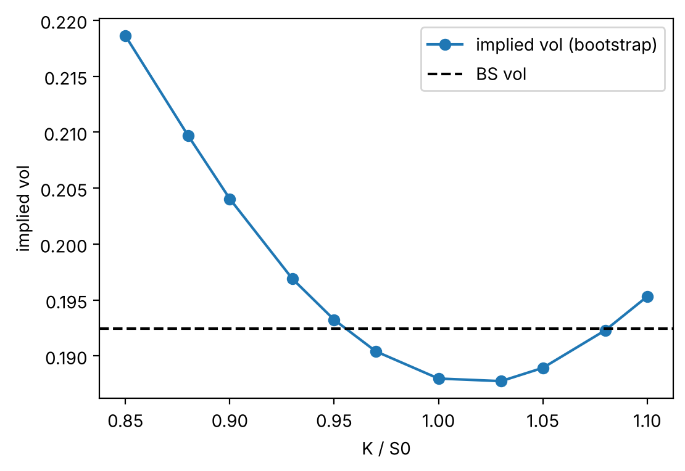

# Black-Scholes vs the S&P 500

This started as a simple check of my Black-Scholes code against a Monte Carlo and a binomial tree (they agree within a few cents, see `02_pricing_check`). Then I wanted to know how far the real S&P 500 is from the model's assumptions, using daily closes from 2000 to 2026.

Pretty far. Daily returns have an excess kurtosis of 10.6 and 46 days beyond 4 standard deviations, where a normal law would give 0.4. The worst day, 16 March 2020, is a 10.6 sigma move. Volatility is not constant either: from 3% to 98% on a one-month window, and it comes in waves.

To see what this does to prices, I priced 1-month options with paths built from the real daily returns (bootstrap) and turned each price into an implied volatility. Black-Scholes uses the same vol for every strike; the real returns don't:

A put 15% below spot ends up worth 3.7 times its Black-Scholes price. That's the skew you see on index options, and it's still too flat here because the bootstrap draws days independently and loses the vol clustering.

`pricing.py` has the pricers (closed form, Monte Carlo, CRR tree, implied vol), the notebooks go 01 → 03. To run locally: `pip install -r requirements.txt`, then `pytest` and `jupyter notebook`.
