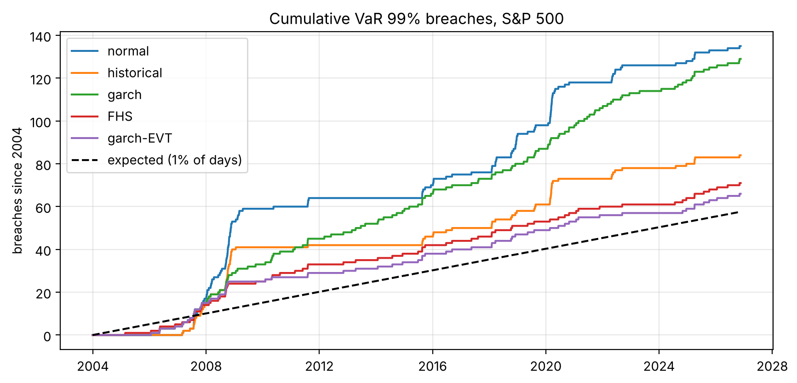

# VaR / Expected Shortfall backtest

How often is a 99% one-day VaR actually breached? It should be 1% of days. I tested five models on the S&P 500 from 2004 to 2026 (5,761 days), each one only using the previous 1000 days, and counted.

| model | breaches | Kupiec | Christoffersen | real loss / ES |
|---|---|---|---|---|
| normal | 2.34% | ✗ | ✗ | 1.39 |
| historical | 1.46% | ✗ | ✗ | 1.07 |
| GARCH, normal errors | 2.24% | ✗ | ✓ | 1.12 |
| GARCH, Student-t errors | 1.53% | ✗ | ✓ | 1.01 |
| GJR-GARCH, Student-t errors | 1.49% | ✗ | ✓ | 1.01 |
| FHS (GARCH + empirical residuals) | 1.23% | ✓ | ✓ | 1.03 |
| GARCH-EVT (generalized Pareto tail) | 1.15% | ✓ | ✗ (p = 0.047) | 1.03 |

You need both a volatility that moves (GARCH) and a tail that isn't normal. Fixing only one isn't enough. Student-t errors help but the t is symmetric, and S&P 500 losses are heavier than gains (residual 1% quantile -2.75 against -2.55 for the fitted t). A GJR-GARCH doesn't change that: the fit says only down days raise the volatility (alpha ≈ 0, gamma = 0.21), but the residuals stay just as skewed, so the asymmetry is in the shocks themselves.

Then I added Apple (data in `data/aapl.csv`) for a 50/50 portfolio. Their correlation swings between 0.2 and 0.9 and jumps in crises, and on the worst 1% of days they fall together 28% of the time, against 20% for a Gaussian dependence. A t copula with ~4.5 degrees of freedom fits better. So diversification only cuts the VaR by 13%, and Apple ends up with 68% of the ES for 50% of the money (36% in Apple would split it equally).

On the portfolio most models get caught in autumn 2008. Two still pass both tests over the full period: a DCC-GARCH version of FHS, where the correlation moves every day (1.20% breaches), and, a bit to my surprise, the GARCH with Student-t errors (1.18%, and 1.25% for the GJR version). The portfolio is less skewed than the index, and the fitted t tail gets through 2008 with 6 breaches where the models built on the calm 2004-07 residuals have 14 to 18.

Notebooks 01-02 are the S&P 500 part, 03-05 the portfolio. The GARCH and DCC likelihood fits, the EVT tail, the copula and the tests are written by hand in `risk.py` (tests in `test_risk.py`).

Things I'd still like to try: a skewed t (Hansen) for the asymmetry, a 10-day horizon like Basel, more than two assets, and equal-risk weights recomputed every year instead of with hindsight.
